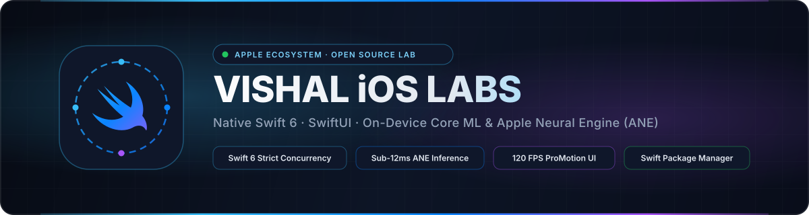

  

    

  
  
  

---

###  What We Build

**Vishal iOS Labs** is an independent Apple-platform engineering studio and open-source lab founded by **[@vishal-rao28](https://github.com/vishal-rao28)**—focused on shipping **zero-dependency Swift 6 packages**, **sub-12ms on-device Core ML pipelines**, and **fluid 120 FPS SwiftUI experiences**.

| Pillar | Engineering Focus |
| :--- | :--- |
| **⚡ On-Device AI & Vision** | Quantized Core ML models running locally on the **Apple Neural Engine (ANE)** with zero cloud latency and full privacy. |
| **🎨 Fluid Native SwiftUI** | Clean MVVM & Swift 6 actor-isolated architectures targeting **120 FPS ProMotion** smoothness across iOS, iPadOS, macOS & visionOS. |
| **🩺 Clinical MedTech** | Production healthcare companions powered by **Apple HealthKit**, Combine telemetry streams, Core Data & PDFKit reporting. |
| **🛡️ Quality Engineering** | Strict Swift 6 concurrency, Swift Testing / XCTest coverage, and automated macOS CI pipelines. |

---

### 📦 Open-Source Packages & Tools

| Package | Platforms | Description | Install |
| :--- | :---: | :--- | :---: |
| **[`SwiftVisionML`](https://github.com/Vishal-iOS-Labs/SwiftVisionML)** | `iOS 17+` · `macOS 14+` · `visionOS` | Zero-dependency Swift 6 actor toolkit for on-device Core ML & Vision inference, exact Vision↔SwiftUI coordinate mapping, frame throttling, and drop-in bounding-box & latency HUD overlays. | `SPM v1.0.0` |

---

### 🤝 Open Source & Collaboration

- ⭐ Star our packages if they help speed up your iOS or Core ML workflow.
- 🐛 Found an edge case or want a new SwiftUI / Core ML utility? Open an Issue or Pull Request!
- 📫 Reach out via **[vishalrao5432@gmail.com](mailto:vishalrao5432@gmail.com)** or **[LinkedIn](https://www.linkedin.com/in/vishal-rao-173a232b9)**.

   Engineered with Swift 6 &amp; Apple Neural Engine · Maintained by <b>Vishal Rao M</b>

